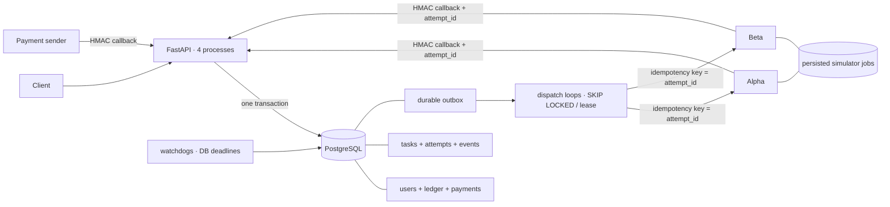
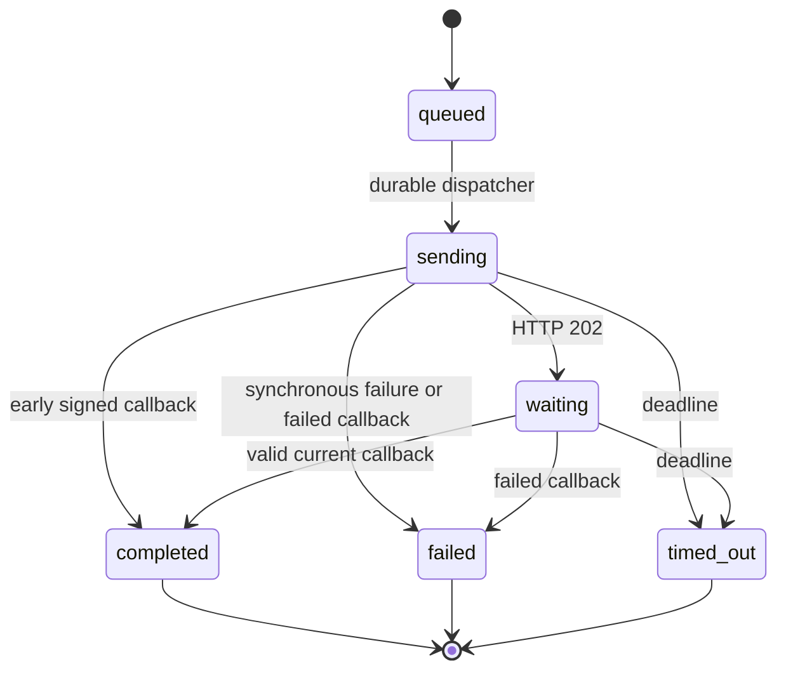

# Архитектура и последовательности

Симуляторы используют ту же PostgreSQL ради минимального Compose, но отдельные таблицы. Никакая бизнес-логика оркестратора не читает `fake_jobs` для определения результата: он узнаёт его только из HTTP-ответов/подписанных callback или собственных дедлайнов.

## Приём

1. Начать транзакцию, заблокировать пользователя.
2. При наличии ключа проверить уже принятый логический запрос и hash нормализованной нагрузки.
3. Получить модель, снимок ног, выбрать первую подходящую; проверить баланс и число активных задач.
4. Записать task, charge, attempt и outbox. Trigger журнала обновляет баланс.
5. Commit. Отложенные constraints проверяют финансовые инварианты.
6. Попытаться отправить первый job; другие процессы независимо читают outbox.

Ошибка между шагами 1–5 откатывает всё. Между 5–6 есть сохранённая работа, а не «списали и забыли».

## Dispatch

Транзакция claim блокирует только строку outbox и быстро завершается. После неё отдельная транзакция берёт user → task → attempt → outbox, проверяет token/текущую попытку и фиксирует `sending` с первоначальным дедлайном. После коммита выполняется HTTP. Затем финализатор снова берёт тот же порядок блокировок и проверяет token.

Нельзя держать outbox row lock во время захвата user lock: другой обработчик может держать user и ждать outbox. Разделение транзакции claim устраняет этот цикл.

Lease защищает не от повторного HTTP в принципе, а от одновременного изменения состояния разными владельцами. Повтор HTTP после неопределённого исхода нейтрализуется provider idempotency key. Номер попытки и ключ не меняются при восстановлении.

## Состояния

| Сущность | Состояния | Терминальные |
|---|---|---|
| Task | active, completed, failed | completed, failed |
| Attempt | queued, sending, waiting, completed, failed, timed_out | completed, failed, timed_out |
| Outbox | pending, done | done |
| Payment | pending, failed, succeeded | succeeded как окончательное подтверждение |

`failed`/`timed_out` одной попытки ещё не обязательно означает `failed` задачи. Общий переход либо создаёт следующую попытку, либо закрывает задачу и возвращает цену. Успешный исход закрывает задачу без возврата. На задачу может существовать не более одной живой попытки — это также защищено partial unique index.

## Почему не отдельный брокер

Проверяемое состояние уже находится в PostgreSQL. Outbox убирает окно между коммитом списания и публикацией события, а SKIP LOCKED позволяет безопасно разбирать сохранённую очередь нескольким процессам. Брокер можно добавить как ускоритель доставки, не делая его единственным местом хранения финансового намерения.

## Чтение и наблюдаемость

`balance`/`ledger_sum`/последние строки читаются одним repeatable-read snapshot. История задачи — тоже один snapshot. Метрики агрегируют общие записи БД, поэтому четыре процесса не требуют четырёх независимых «счётчиков истины». Для production-нагрузки тяжёлые суммы и histogram можно вынести в материализованные агрегаты, сохранив журнал для сверки.
